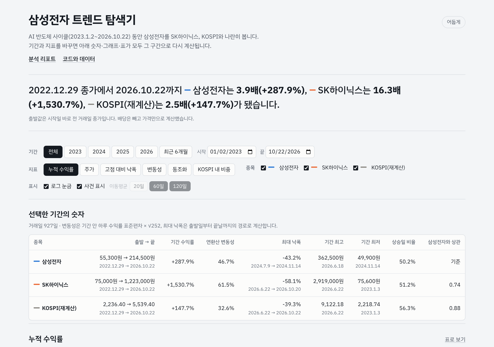
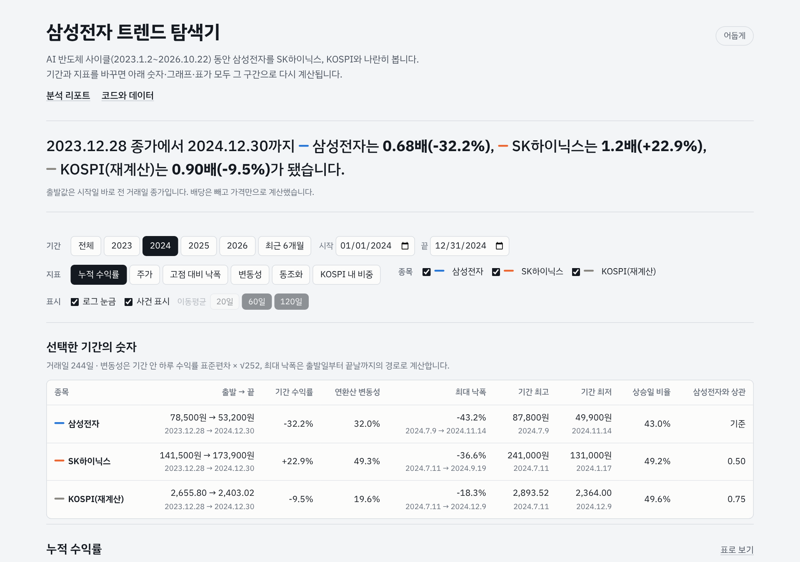
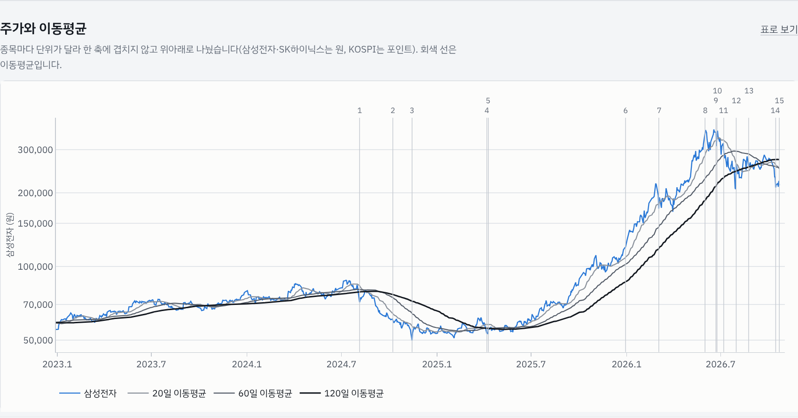
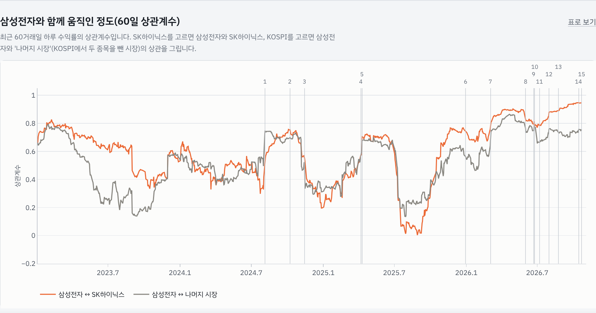
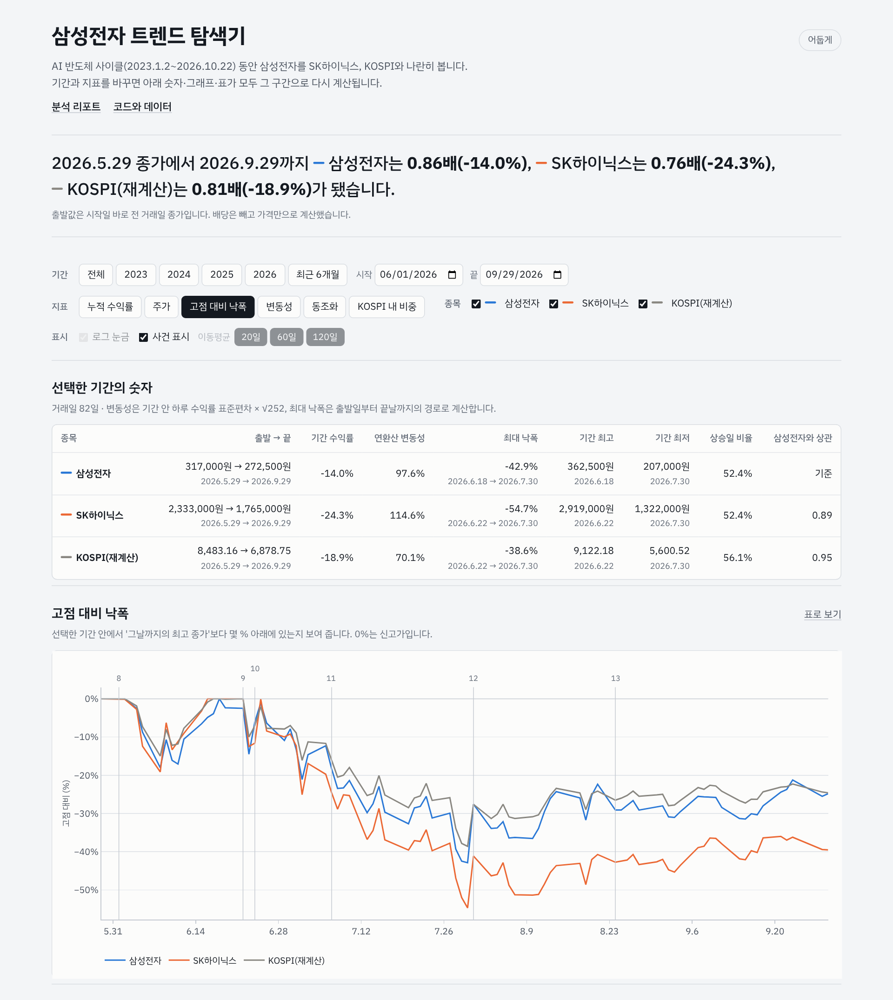
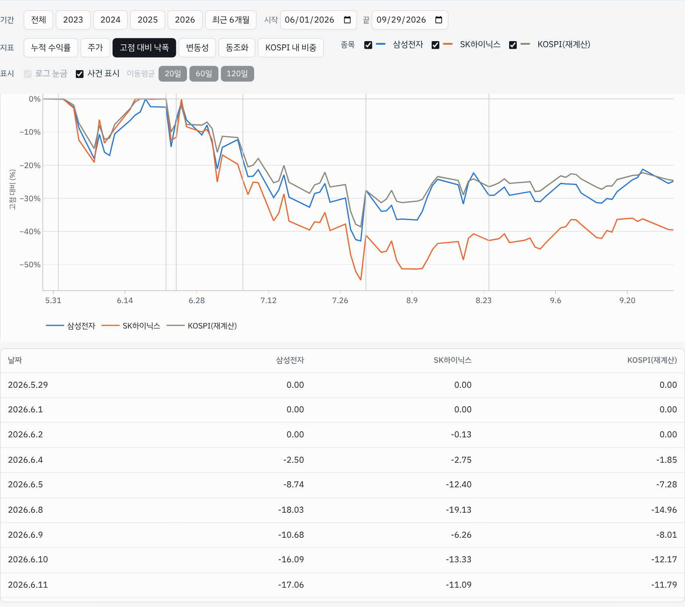
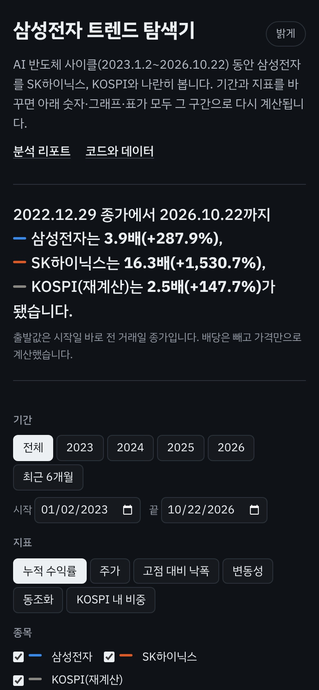

# 웹 대시보드: 삼성전자 트렌드 탐색기 (보너스 과제)

- **배포 주소:** <https://sungtae10.github.io/codyssey-semiconductor-trend-analysis-M1-1/> (GitHub Pages, `docs/` 폴더 배포)
- **하는 일:** 리포트의 그림은 고정된 한 장면이다. 대시보드는 기간·지표·종목을 바꾸면 **숫자 표, 그래프, 월별 수익률 표를 그 구간으로 다시 계산**해서, 리포트의 주장을 다른 기간에서도 직접 확인하게 해 준다.
- **제출 형식:** 미션 보너스의 (1) 배포 URL과 (3) 스크린샷 세트 + 기간·조건 변경 시나리오를 함께 제출한다.

## 실행 방법

| 방법 | 명령 |
|---|---|
| 배포 주소로 열기 | 위 주소를 브라우저에서 연다 |
| 로컬 서버 | 저장소 루트에서 `python -m http.server 8000 -d docs` 실행 후 <http://localhost:8000> |
| 파일로 열기 | `docs/index.html`을 더블클릭 (데이터를 JS 파일로 넣어 두어 서버 없이도 열린다) |
| 데이터 갱신 | `python -m src.run_all` 이 `docs/data/dashboard-data.js`를 다시 만든다 |

## 화면 구성

| 영역 | 내용 |
|---|---|
| 읽어 주는 문장 | 선택한 기간에 세 시계열이 몇 배가 됐는지 한 문장으로 다시 써 준다 |
| 보기 설정 | 기간(전체·2023·2024·2025·2026·최근 6개월, 날짜 직접 지정), 지표 6종, 종목 선택, 로그 눈금, 사건 표시, 이동평균(20·60·120일) |
| 선택한 기간의 숫자 | 출발 → 끝 가격, 기간 수익률, 연환산 변동성, 최대 낙폭(날짜 포함), 기간 최고·최저, 상승일 비율, 삼성전자와의 상관 |
| 그래프 | 지표에 따라 바뀐다. 마우스를 올리면 그날 모든 종목 값을 한 번에 보여 주고, '표로 보기'를 누르면 같은 값을 표로 확인한다 |
| 월별 수익률 | 종목을 고르면 연도 × 월 표가 바뀌고, 선택 기간 밖의 달은 흐리게 보인다 |
| 출처로 확인한 사건 | 기사로 확인한 사건 15개. '전후 보기'를 누르면 그날 앞뒤 60일로 기간이 바뀐다 |

**지표 6종:** 누적 수익률(시작일 직전 거래일 = 100), 주가와 이동평균(종목별로 위아래 패널을 나눠 이중 축을 쓰지 않음), 고점 대비 낙폭, 20일 변동성, 동조화(60일 상관), KOSPI 내 비중.

## 기간·조건 변경 시나리오

### 시나리오 1. 첫 화면: 전체 기간

- **조작:** 없음 (전체 기간, 누적 수익률, 세 종목, 로그 눈금)
- **확인할 것:** 문장이 '삼성전자 3.9배(+287.9%), SK하이닉스 16.3배(+1,530.7%), KOSPI(재계산) 2.5배(+147.7%)'로 리포트 Q2와 같다. 숫자 표의 변동성 46.7%, 최대 낙폭 -43.2%도 리포트와 같다.

### 시나리오 2. 2024년만 보기: '격차의 해'

- **조작:** 기간 → `2024`
- **확인할 것:** 문장이 2023.12.28 종가 기준으로 바뀌고 삼성전자 0.68배(-32.2%), SK하이닉스 1.2배(+22.9%), KOSPI 0.90배(-9.5%)가 된다. 삼성전자와 SK하이닉스의 상관이 전체 기간(0.74)보다 낮은 0.50으로 바뀐다. 리포트 인사이트 1의 근거를 화면에서 바로 확인할 수 있다.

### 시나리오 3. 주가와 이동평균: 추세 전환 확인

- **조작:** 기간 `전체` → 지표 `주가` → 종목에서 SK하이닉스·KOSPI 끄기 → 이동평균 `20일` 켜기
- **확인할 것:** 2024년 하반기 60일선이 120일선 아래로 내려가는 구간(하락 국면), 2025년 4월 두 선이 붙어 여러 번 교차하는 구간, 2026년 9월 다시 아래로 꺾이는 구간. 위쪽 숫자는 사건 번호이며 마우스를 올리면 사건 이름이 보인다.

### 시나리오 4. 동조화: 2026년에 함께 움직임

- **조작:** 종목 SK하이닉스·KOSPI 다시 켜기 → 지표 `동조화`
- **확인할 것:** 2026년에는 주황 선(삼성전자 ↔ SK하이닉스)이 0.67~0.95, 회색 선(삼성전자 ↔ 나머지 시장)이 0.46~0.86 범위에 머물러 두 선 모두 대부분의 2023~2025년 구간보다 높다. 반대로 2025-08-29에는 SK하이닉스와의 60일 상관이 0.003까지 내려가 두 종목이 거의 따로 움직였다.

### 시나리오 5. 사건 전후 보기: 2026년 7월 급락과 사상 최대 반등

- **조작:** 지표 `고점 대비 낙폭` → 사건 목록 12번 '사상 최대 일간 상승(2026.7.31)'의 `전후 보기`
- **확인할 것:** 기간이 2026-06-01 ~ 2026-09-29로 바뀌고, 기간 수익률이 삼성전자 -14.0%, SK하이닉스 -24.3%로 다시 계산된다. 7월 28~30일 급락 뒤 31일 반등이 낙폭 그래프에서 V자로 보인다.

### 시나리오 6. 표로 보기 (그래프를 표로 확인)

- **조작:** 그래프 오른쪽 위 `표로 보기`
- **확인할 것:** 그래프에 그려진 모든 값이 날짜별 표로 나온다. 마우스 없이도 값을 읽을 수 있게 만든 대체 수단이다.

### 시나리오 7. 휴대폰 화면 + 어두운 화면

- **조작:** 휴대폰으로 열거나 오른쪽 위 `어둡게` 버튼
- **확인할 것:** 폭 390px에서도 가로 스크롤 없이 설정이 줄바꿈되고, 어두운 화면에서는 종목 색이 어두운 배경용 색으로 바뀐다.

## 계산 방식과 자동 점검

- 기간 수익률 = 끝날 종가 ÷ 시작일 직전 거래일 종가 − 1. 연환산 변동성 = 기간 안 하루 수익률의 표본 표준편차 × √252. 최대 낙폭 = 시작일 직전 거래일부터 끝날까지의 경로에서 계산. 모두 `src/metrics.py`와 같은 정의다.
- `python tools/check_dashboard.py` (Playwright, 헤드리스 Chromium)가 아래를 확인하고 위 스크린샷을 다시 찍는다.
  - 콘솔 오류 0건
  - 전체 기간과 2024년에서 브라우저가 계산한 수익률·변동성·최대 낙폭이 파이썬 계산과 같음 (3종목 × 3지표 × 2기간)
  - '전후 보기'가 정확히 앞뒤 60일로 기간을 바꿈, '표로 보기' 표가 채워짐
  - 폭 390px에서 가로 스크롤이 생기지 않음
- 마지막 점검 결과: 콘솔 오류 없음, 문제 없음.

## 기술 메모

- 순수 HTML·CSS·JavaScript와 Plotly 2.35.2(basic 번들, MIT 라이선스, `docs/vendor/`)만 쓴다. 서버가 필요 없어 GitHub Pages에 그대로 올라간다.
- 글꼴: IBM Plex Sans KR(Google Fonts). 불러오지 못하면 시스템 한글 글꼴로 바뀐다.
- 색은 리포트 그림과 같다(삼성전자 파랑, SK하이닉스 주황, KOSPI 회색). 월별 표는 국내 증시 관례대로 빨강 = 상승, 파랑 = 하락.
