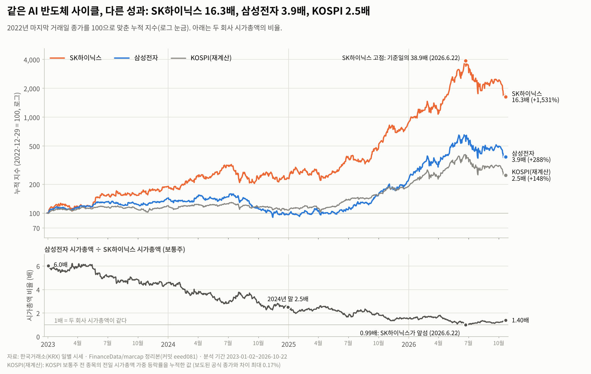

# 삼성전자 주가 트렌드 분석 (2023.1 ~ 2026.10)

AI 반도체 사이클 동안 삼성전자 주가가 어떻게 움직였는지 한국거래소(KRX) 일별 시세 927거래일로 분석했다. 같은 메모리 반도체 회사인 SK하이닉스, 그리고 같은 원천 데이터로 다시 계산한 KOSPI와 나란히 비교한다.

**평가 항목별 안내:** 미션 요구사항마다 무엇을 했고 어디서 확인하는지는 [EVALUATION_GUIDE.md](EVALUATION_GUIDE.md)에 정리했다.



| 2022-12-29 → 2026-10-22 | 삼성전자 | SK하이닉스 | KOSPI(재계산) |
|---|---|---|---|
| 누적 수익률 | +287.9% (3.9배) | +1,530.7% (16.3배) | +147.7% (2.5배) |
| 연환산 변동성 | 46.7% | 61.5% | 32.6% |
| 최대 낙폭 | -43.2% (2024.7.9 → 2024.11.14) | -58.1% (2026.6.22 → 2026.10.20) | -39.3% (2026.6.22 → 2026.10.22) |

## 결과물 바로가기

| 결과물 | 위치 |
|---|---|
| 평가 항목별 안내 (미션 요구사항 → 한 일 → 확인 위치) | [EVALUATION_GUIDE.md](EVALUATION_GUIDE.md) |
| 분석 리포트 (주제, 질문, 데이터, 시각화, 인사이트, 결론·한계, AI 사용 로그) | [REPORT.md](REPORT.md) |
| 분석 노트북 (실행 결과 포함) | [analysis.ipynb](analysis.ipynb) |
| 웹 대시보드 (보너스, 기간·지표를 바꿔 다시 계산) | <https://sungtae10.github.io/codyssey-semiconductor-trend-analysis-M1-1/> · 사용 시나리오 [DASHBOARD.md](DASHBOARD.md) |
| 그림 8장 | [images/](images) |
| 데이터 출처·수집 방법·컬럼 사전·라이선스 주의 | [data/README.md](data/README.md) |
| 계산 결과표 (리포트 숫자의 원본) | [results/](results) |

## 폴더 구조

```
codyssey-semiconductor-trend-analysis-M1-1/
├── REPORT.md                  분석 리포트 (미션 필수 결과물)
├── EVALUATION_GUIDE.md        평가 항목별 안내 (미션 요구사항마다 한 일과 확인 위치)
├── analysis.ipynb             노트북: 데이터 확인 → 정제 → 지표 → 그림 → 보너스 (출력 포함)
├── DASHBOARD.md               대시보드 실행 방법과 기간·조건 변경 시나리오
├── index.html                 GitHub Pages 첫 주소에서 대시보드(docs/)로 넘겨 주는 연결 페이지
├── requirements.txt           의존성 목록
├── src/                       분석 코드 (노트북과 스크립트가 같은 함수를 쓴다)
│   ├── config.py              기간·창 길이·경로·색 설정
│   ├── fetch_data.py          KRX 일별 시세 수집 (고정 커밋, SHA-256 확인)
│   ├── prepare.py             원자료 → 분석용 일별 테이블
│   ├── quality.py             결측치·이상치·휴장일·교차 출처 점검
│   ├── metrics.py             이동평균, 수익률, 변동성, 낙폭, 상관, 달력 효과
│   ├── advanced.py            보너스: STL 분해, 베이스라인 예측 백테스트
│   ├── plots.py               그림 8장
│   ├── build_dashboard.py     대시보드 데이터 파일 생성
│   └── run_all.py             전체 파이프라인 실행
├── data/
│   ├── raw/                   삼성전자·SK하이닉스 일별 시세, KOSPI 시장 집계
│   ├── processed/             분석용 일별 테이블 (지표 포함)
│   ├── reference/             휴장일 참고표, 공식 수치 대조표, 사건 목록(출처 포함)
│   └── manifest.json          원천 커밋·파일 해시·행 수
├── images/                    리포트 그림 (01~08)
├── results/                   metrics.json, 품질 점검 결과, 결과표 CSV
├── docs/                      웹 대시보드 (GitHub Pages로 공개)
├── tests/                     단위 테스트, 데이터 품질 테스트, 리포트 숫자 감사
└── tools/                     휴장일 표 생성, 대시보드 자동 점검, 리포트 표 생성
```

## 실행 방법

Python 3.10 이상이 필요하다.

**Windows (PowerShell)**

```powershell
git clone https://github.com/Sungtae10/codyssey-semiconductor-trend-analysis-M1-1.git
cd codyssey-semiconductor-trend-analysis-M1-1
python -m venv .venv
Set-ExecutionPolicy -Scope Process -ExecutionPolicy Bypass   # 가상환경 활성화가 막힐 때만
.venv\Scripts\Activate.ps1
python -m pip install -r requirements.txt
```

**macOS / Linux**

```bash
git clone https://github.com/Sungtae10/codyssey-semiconductor-trend-analysis-M1-1.git
cd codyssey-semiconductor-trend-analysis-M1-1
python3 -m venv .venv && source .venv/bin/activate
python -m pip install -r requirements.txt
```

**실행 순서 (저장소 루트에서)**

| 순서 | 명령 | 하는 일 | 걸리는 시간 |
|---|---|---|---|
| 1 | `python -m unittest discover -s tests` | 테스트 27개: 지표 정의, 데이터 품질, 리포트 숫자 감사 | 약 1초 |
| 2 | `python -m src.run_all` | 지표·그림 8장·결과표·대시보드 데이터 재생성 | 약 10초 |
| 3 | `jupyter notebook analysis.ipynb` → 메뉴에서 전체 실행 | 단계별 확인 (VS Code에서 열어도 된다) | 약 20초 |
| 4 (선택) | `python -m src.fetch_data` | 원천에서 parquet 5개(약 120MB)를 다시 받아 `data/raw/`를 재생성. 고정 커밋이라 같은 파일이 나온다 | 네트워크에 따라 1~3분 |

4번 뒤 `git status`에 변경이 없으면 원자료가 바이트 단위까지 같다는 뜻이다. 최신 데이터로 바꾸려면 `python -m src.fetch_data --ref master --end 2026-12-31`(이 경우 리포트 숫자와 달라진다).

**대시보드 로컬 실행:** `python -m http.server 8000 -d docs` 실행 후 <http://localhost:8000> 접속. 인터넷 없이도 열리도록 그래프 라이브러리(Plotly 2.35.2, MIT)를 `docs/vendor/`에 넣어 두었다.

## 사용 라이브러리와 검증한 환경

| 환경 | Python | pandas | numpy | matplotlib | scipy | statsmodels | pyarrow |
|---|---|---|---|---|---|---|---|
| 작성 환경 (최신 버전) | 3.13.17 | 3.0.5 | 2.5.3 | 3.11.2 | 1.18.1 | 0.15.0 | 26.0.0 |
| 하한 버전 환경 (`requirements.txt` 하한 그대로) | 3.10.20 | 2.2.0 | 1.26.0 | 3.9.0 | 1.11.1 | 0.14.1 | 15.0.0 |

하한 버전 환경에서는 GitHub에서 저장소를 새로 내려받아 테스트 27개, `python -m src.fetch_data`, `python -m src.run_all`, 노트북 전체 실행(오류 0개, 그림 8장)을 모두 확인했다. 다시 만든 `data/`·`results/`·`docs/data/` 파일은 저장소에 올린 파일과 바이트 단위까지 같았고, 그림 PNG만 matplotlib 버전과 글꼴에 따라 글자 모양이 조금 달라졌다. 그림의 한글 글꼴은 Windows에서 '맑은 고딕', macOS에서 'AppleGothic', Linux에서 '나눔고딕'이나 'Noto Sans CJK'를 자동으로 고른다.

**문제가 생길 때**

| 증상 | 원인과 해결 |
|---|---|
| 노트북에서 `cannot import name 'backend2gui'` 오류 | matplotlib 3.8 이하와 IPython 9를 함께 쓸 때 생긴다. `python -m pip install -U matplotlib`로 올린 뒤 커널을 다시 시작한다 |
| 그림의 한글이 네모 칸으로 나옴 | 한글 글꼴이 없는 경우다. Linux는 `sudo apt install fonts-nanum` 등으로 글꼴을 설치하고 `~/.cache/matplotlib` 폴더를 지운 뒤 다시 실행한다 |

## 데이터 출처와 이용 주의

- 원천: 한국거래소(KRX) 정보데이터시스템 전종목 시세. 수집 경로: 공개 저장소 [FinanceData/marcap](https://github.com/FinanceData/marcap), 커밋 `eeed081`로 고정.
- 시세 데이터의 원 권리는 한국거래소에 있다. 이 저장소에는 학습·비상업 목적의 재현을 위해 두 종목 일별 시세와 KOSPI 집계값만 들어 있다. 상업적 이용·재배포 전에는 KRX 이용 조건을 확인해야 한다.
- 자세한 내용: [data/README.md](data/README.md)

## AI 사용 고지

이 프로젝트는 Claude(Anthropic의 AI)를 코딩·분석 도구로 사용했다. 어떤 작업에 왜 썼고 어떻게 검증했는지는 [REPORT.md의 AI 사용 로그](REPORT.md#10-ai-사용-로그)에 정리했다. 분석 결과는 학습용이며 투자 권유가 아니다.
