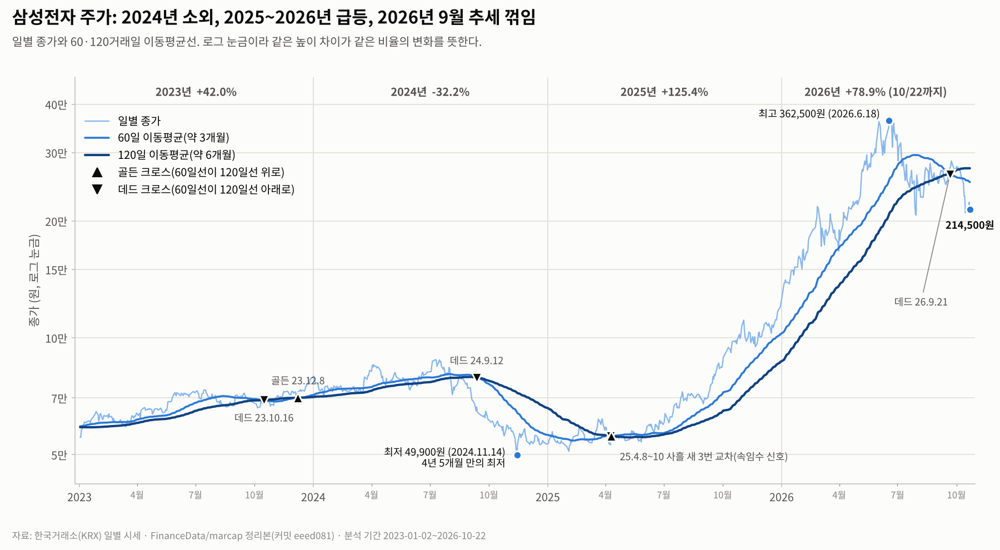
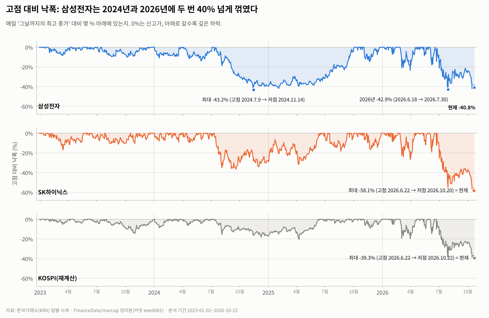
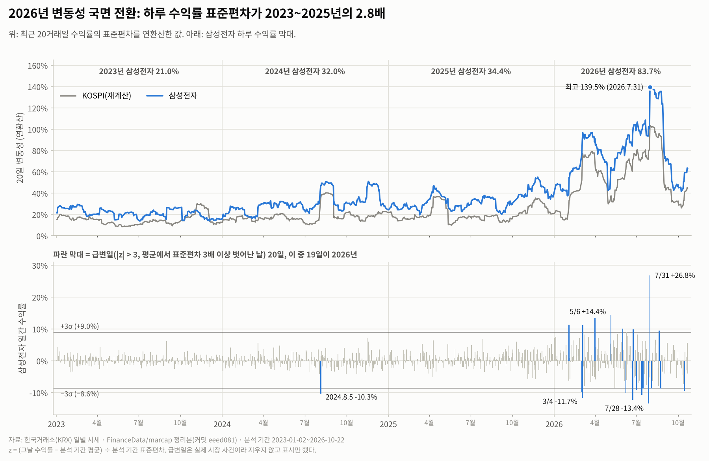
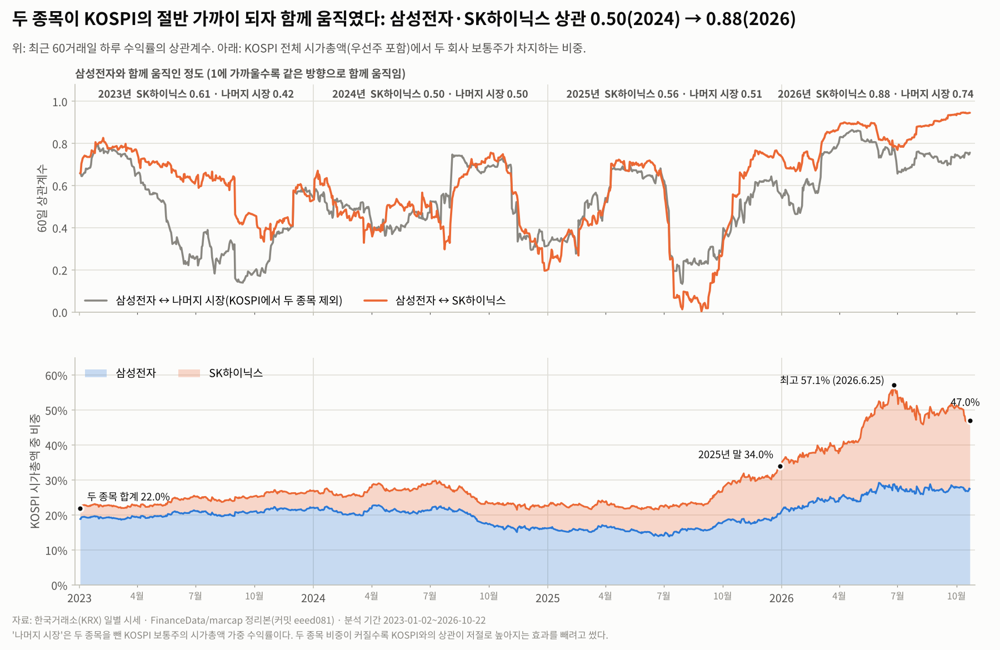
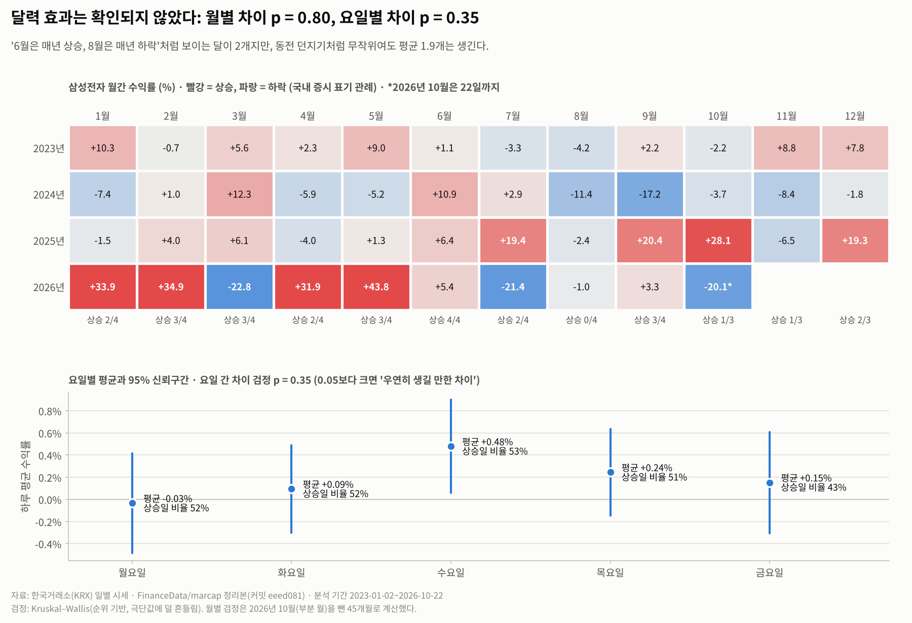
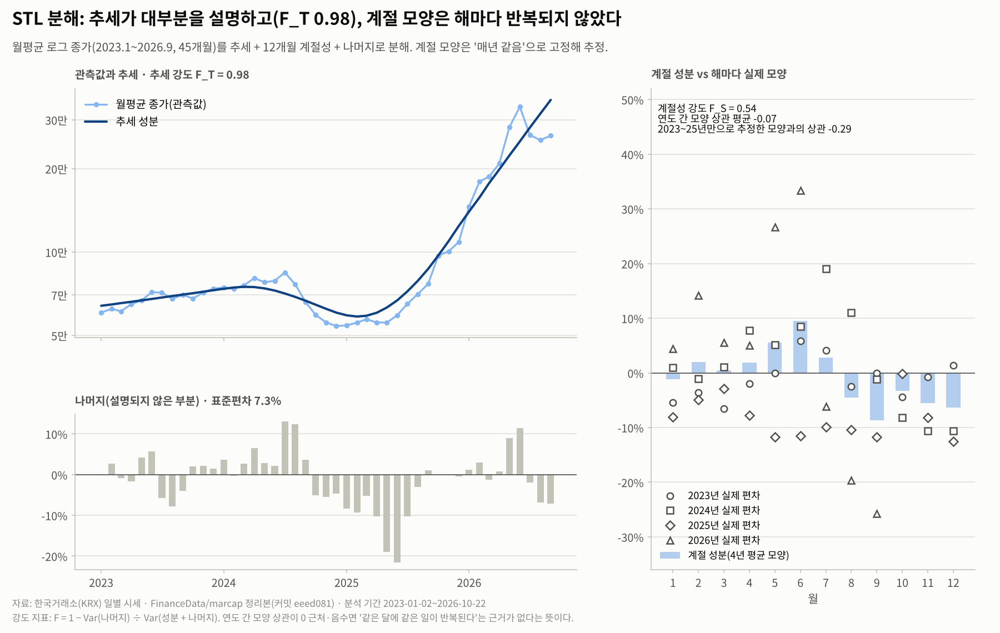
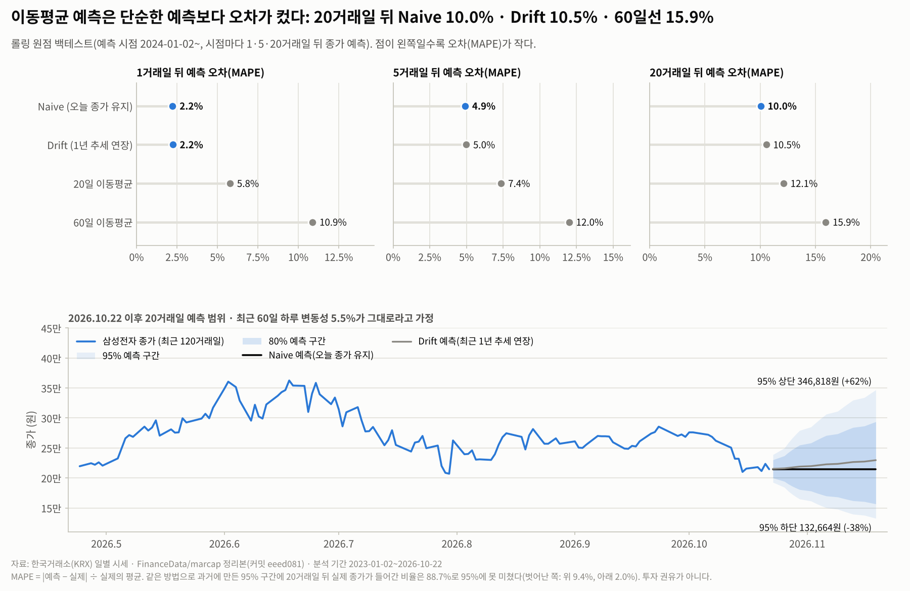

# AI 반도체 사이클 속 삼성전자 주가 트렌드 분석 (2023.1 ~ 2026.10)

> 2022년 말 종가 대비 삼성전자는 **3.9배(+287.9%)** 올랐다. 같은 기간 SK하이닉스는 **16.3배(+1,530.7%)**, KOSPI(재계산)는 **2.5배(+147.7%)** 였다.
> 이 기간은 세 장면으로 정리된다. ① 2024년 삼성전자만 크게 밀린 '격차의 해', ② 2026년 하루 수익률 표준편차가 2023~2025년의 2.8배로 커진 '급등락의 해', ③ 두 회사가 KOSPI 시가총액의 절반을 넘고 시장과의 상관도 높아진 '쏠림'.

- 작성: 김성태 (코디세이 AI 네이티브 과정, AI 데이터 분석 미션)
- 데이터 기준일: 2026-10-22 (분석 기간 마지막 거래일)
- 웹 대시보드: <https://sungtae10.github.io/codyssey-semiconductor-trend-analysis-M1-1/> (기간·지표를 바꿔 가며 숫자를 다시 계산)
- 실행 방법과 폴더 구조: [README.md](README.md)

## 목차

1. [요약](#0-요약)
2. [분석 주제와 선정 이유](#1-분석-주제와-선정-이유)
3. [분석 질문](#2-분석-질문)
4. [데이터 설명](#3-데이터-설명)
5. [데이터 정제: 결측치·이상치 처리 기준](#4-데이터-정제-결측치이상치-처리-기준)
6. [분석 방법](#5-분석-방법)
7. [분석 결과와 시각화](#6-분석-결과와-시각화)
8. [핵심 인사이트](#7-핵심-인사이트)
9. [보너스: 대시보드, 시계열 분해, 베이스라인 예측](#8-보너스-대시보드-시계열-분해-베이스라인-예측)
10. [결론과 한계점](#9-결론과-한계점)
11. [AI 사용 로그](#10-ai-사용-로그)
12. [재현 방법](#11-재현-방법)
13. [참고 자료](#12-참고-자료)

---

## 0. 요약

| 질문 | 관찰(데이터로 확인한 사실) | 해석(가설) |
|---|---|---|
| Q1 추세 | 연도별 +42.0% → -32.2% → +125.4% → +78.9%(10/22까지). 60·120일선 데드 크로스(2024-09-12)부터 골든 크로스(2025-04-10)까지가 하락 국면, 2026-09-21에 다시 데드 크로스 | 2024년 하락 국면은 3분기 실적 부진·HBM 경쟁력 우려 보도와 시기가 겹친다 |
| Q2 상대 성과 | 4년 모두 SK하이닉스보다 낮았다. 격차가 가장 크게 벌어진 해는 방향까지 반대였던 2024년(-32.2% vs +22.9%, 4년 격차의 41%). 2026-06-22 이후 하락장에서는 격차가 좁혀졌다(시가총액 비율 0.99배 → 1.40배) | AI용 HBM 공급 경쟁의 차이가 이익 기대 차이로 이어졌을 가능성 |
| Q3 변동성 | 2026년 연환산 변동성 83.7%(2023년 21.0%). 급변일 20일 중 19일이 2026년이고, 20일 중 19일은 나머지 시장도 같은 방향 | 2026년 하락·반등은 대부분 시장 전체 충격(전쟁 우려, 레버리지 강제 매도, 미국 긴축 우려) |
| Q4 동조화 | 삼성전자·SK하이닉스 상관 0.50(2024) → 0.88(2026). 두 회사 KOSPI 비중 22.0% → 최고 57.1% | 쏠림이 커지고 시장 전체 충격이 잦아지면서 분산 효과가 줄었다. 변동성이 클 때 상관이 높게 측정되는 효과도 섞였을 수 있다 |
| Q5 계절성 | 월별 차이 p = 0.80, 요일별 차이 p = 0.35, STL 계절성 강도 0.28, 추세를 뺀 월별 값의 연도 간 상관 평균 +0.11 | 이 표본에서는 달력 효과가 확인되지 않음 |

**결론:** 이 기간 삼성전자 주가는 '계절'보다 '국면'으로 더 잘 설명됐다. 2024년에는 시장보다 깊게 빠졌고(회사 고유 요인이라는 가설), 2025년부터 2026년 6월까지는 반도체 랠리에 올라탔지만 2026년에는 시장 전체의 급등락에 묶였다. 가격 수준 예측에서는 '내일 = 오늘'보다 나은 단순한 방법을 찾지 못했다. 그래서 의사결정에는 가격 예측보다 국면(추세·변동성·쏠림) 진단에 힘을 쓰자는 것이 이 분석의 제안이다(직접 검증하지 않은 가설).

---

## 1. 분석 주제와 선정 이유

**주제:** ChatGPT 공개(2022-11-30) 뒤 이어진 'AI 반도체 사이클' 동안 삼성전자 주가가 어떤 흐름을 보였고, 같은 메모리 반도체 회사인 SK하이닉스, 그리고 시장 전체(KOSPI)와 비교해 무엇이 달랐는지 시계열로 확인한다.

**선정 이유**

1. **대표성:** 삼성전자는 분석 기간 대부분 KOSPI 시가총액 1위 종목이라 한국 시장 흐름을 대표하는 시계열이다.
2. **비교 가능성:** 같은 업종의 SK하이닉스와 나란히 놓으면 '업황 같은 공통 요인'과 '회사 경쟁력 같은 고유 요인'을 나눠 보는 연습을 할 수 있다. 기술경영(반도체·AI 전략) 관점에서 가장 궁금한 질문이기도 하다.
3. **학습 가치:** 2026년의 급등락은 추세·변동성·이상치 처리·예측의 한계를 실제 데이터로 시험하기 좋은 구간이다.

**분석 대상:** 주 시계열은 **삼성전자 보통주(005930) 일별 종가**다. SK하이닉스(000660)와 KOSPI(재계산)는 같은 형식의 비교 기준선으로 쓴다.

---

## 2. 분석 질문

| # | 질문 | 성격 | 사용 기법 | 그림 |
|---|---|---|---|---|
| Q1 | 2023~2026년 삼성전자 주가의 추세는 어떤 국면을 거쳤고, 추세가 바뀐 시점은 언제인가? | 그래프로 확인 | 60·120일 이동평균, 골든·데드 크로스, 연도별 수익률 | 그림 1 |
| Q2 | 같은 기간 SK하이닉스·KOSPI보다 잘했나? 격차는 언제 벌어지고 언제 좁혀졌나? | 그래프 + 해석 | 기준일 = 100 누적 지수, 연도별 비교, 상대 성과(비율)·로그 격차 분해, 시가총액 비율 | 그림 2 |
| Q3 | 변동성은 언제 커졌고, 급변일은 시장 전체 충격과 겹치는가? | 그래프 + 해석 | 고점 대비 낙폭, 20일 롤링 변동성, z-점수, 나머지 시장과 비교 | 그림 3, 4 |
| Q4 | 삼성전자는 시장·SK하이닉스와 얼마나 함께 움직였고, 그 정도는 변했나? | 해석 | 60일 롤링 상관, 연도별 상관, 시가총액 비중 | 그림 5 |
| Q5 | 특정 달이나 요일에 오르내리는 반복 패턴(계절성)이 있는가? | 해석(검정) | 월별·요일별 집계, Kruskal-Wallis 검정, STL 분해 | 그림 6, 7 |

---

## 3. 데이터 설명

### 3.1 출처와 기간

| 항목 | 내용 |
|---|---|
| 원천 | 한국거래소(KRX) 정보데이터시스템 '전종목 시세' 일별 자료 [1] |
| 수집 경로 | KRX 전종목 시세를 연도별 파일로 정리해 매일 자동 갱신하는 공개 저장소 FinanceData/marcap [2], **커밋 `eeed081`(2026-10-23 갱신분)으로 고정** |
| 분석 기간 | **2023-01-02 ~ 2026-10-22, 927거래일** (2023년 245일, 2024년 244일, 2025년 242일, 2026년 196일) |
| 준비 구간 | 2022-07-01 ~ 2022-12-29, 125거래일. 120일 이동평균을 분석 첫날부터 계산하려고 함께 받았다(분석 통계에는 넣지 않음) |
| 기준일 | 2022-12-29 종가 = 100 (2022년 마지막 거래일). 연도별 수익률도 '직전 연도 마지막 거래일 종가' 대비로 계산 |
| 데이터 수 | 종목 원자료 2,104행(2종목 × 1,052거래일), KOSPI 집계 1,052행. 분석 기간 시계열 3개 × 927개 데이터 포인트 |

### 3.2 컬럼 사전

`data/raw/krx_daily_005930_000660.csv` (삼성전자·SK하이닉스 일별 시세)

| 컬럼 | 뜻 | 단위 |
|---|---|---|
| Date | 거래일 | 날짜 |
| Code / Name | 종목코드 / 종목명 | |
| Open, High, Low, Close | 시가, 고가, 저가, 종가 | 원 |
| Volume / Amount | 거래량 / 거래대금 | 주 / 원 |
| Changes / ChangesRatio | 전일 대비 / 등락률 (KRX 공식 값) | 원 / % |
| Marcap / Stocks | 시가총액 / 상장주식수 | 원 / 주 |

`data/raw/kospi_market_daily.csv` (KOSPI 시장 집계, 같은 원천에서 직접 계산)

| 컬럼 | 뜻 |
|---|---|
| n_constituents | 그날 계산에 들어간 KOSPI 보통주 종목 수 |
| ret_kospi_pct | KOSPI 시장 하루 수익률(%): 전일 시가총액 가중 등락률 |
| ret_ex2_pct | 삼성전자·SK하이닉스를 뺀 '나머지 시장' 하루 수익률(%) |
| mcap_kospi_total / mcap_kospi_common | KOSPI 전체 시가총액(우선주 포함) / 보통주 시가총액 (원) |

### 3.3 KOSPI를 직접 계산한 이유와 검증

- KOSPI 공식 지수의 일별 자료는 무료로 받으려면 API 키나 별도 사이트 내려받기가 필요해서, 다른 사람이 같은 결과를 재현하기 어렵다. 그래서 **같은 KRX 원천 데이터로 시장 수익률을 직접 계산**했다.
- 계산식: 하루 수익률 = Σ(전일 시가총액 × 당일 KRX 등락률) ÷ Σ(전일 시가총액). 대상은 KOSPI 지수 정의와 같은 **유가증권시장 보통주** [3]이며, 전일과 당일 모두 거래된 종목만 넣었다(신규 상장 첫날·거래정지 다음 날 제외).
- 2022-12-29 공식 종가 2,236.40 [4]에서 출발해 누적한 값을 'KOSPI(재계산)'이라 부른다.
- **검증 결과:** 언론에 보도된 공식 종가 14개 시점과 비교해 차이가 **최대 0.17%, 평균 0.11%** 였다. 하루 등락률은 10개 시점에서 차이가 최대 0.011%p였다. 표 전체는 [results/tables/checkpoint_validation.csv](results/tables/checkpoint_validation.csv).

| 날짜 | 공식 종가(보도) | 재계산 | 차이 | 출처 |
|---|---|---|---|---|
| 2023.12.28 | 2,655.28 | 2,655.80 | +0.02% | [5] |
| 2024.8.5 | 2,441.55 | 2,444.21 | +0.11% | [7] |
| 2024.12.30 | 2,399.49 | 2,403.02 | +0.15% | [6] |
| 2025.4.10 | 2,445.06 | 2,449.25 | +0.17% | [11] |
| 2025.12.30 | 4,214.17 | 4,219.32 | +0.12% | [12] |
| 2026.6.22 | 9,114.55 | 9,122.18 | +0.08% | [15] |
| 2026.10.22 | 5,533.77 | 5,539.40 | +0.10% | [21] |

### 3.4 라이선스와 이용 주의

- 시세 데이터의 원 권리는 한국거래소에 있다. 이 저장소는 **학습·비상업 목적의 재현성**을 위해 두 종목의 일별 시세와 KOSPI 집계값만 담았다. 상업적으로 쓰거나 다시 배포하려면 KRX 정보데이터시스템 이용 조건을 먼저 확인해야 한다.
- 수집 경로인 FinanceData/marcap 저장소에는 라이선스 파일이 없다(커밋 `eeed081` 기준).
- 뉴스 기사는 사건의 날짜·수치를 확인하는 출처로만 링크했고 본문을 옮기지 않았다.

---

## 4. 데이터 정제: 결측치·이상치 처리 기준

| 점검 | 기준 | 결과 | 처리 |
|---|---|---|---|
| 결측치 | 모든 열의 빈 값 개수 | **0개** | 처리할 것 없음 |
| 거래일 누락 | 데이터와 따로 공휴일 달력(holidays.KR)과 KRX 휴장 규정으로 만든 휴장일 목록과 두 방향으로 대조 | 데이터에 없는 평일 67일이 **모두 휴장일**(공휴일 61일 + 근로자의 날·연말 휴장 6일)이고, **휴장일인데 거래된 날은 0일** ([휴장일 참고표](data/reference/krx_closures_2023_2026.csv)) | 결측이 아니므로 채우지 않음 |
| 중복 | (날짜, 종목) 중복 | 0건 | |
| 오류형 이상치 | 저가 ≤ 시가·종가 ≤ 고가, 가격·거래량 > 0, 하루 등락 ±30% 이내(가격제한폭), 전일 대비 = 종가 차이, 등락률 = 계산 수익률 | **0건** | 고칠 값이 없어 제거·수정 없음 |
| 통계적 극단값 | \|z\| > 3, z = (그날 수익률 − 분석 기간 평균) ÷ 분석 기간 표준편차 | 삼성전자 20일(하루 +9.0% 초과 또는 -8.6% 미만), SK하이닉스 13일, KOSPI 21일 | **지우지 않고 '급변일'로 표시** |
| 교차 출처 대조 | 언론 보도 수치 51개(종가·등락률·시가총액). 재계산의 출발값인 2022-12-29 KOSPI 종가는 정의상 오차가 0이라 개수에서 뺐다 | **51개 모두 허용 오차 안**. 종목 수치 25개(종가·등락률·시가총액)는 보도된 자릿수까지 같다 | 데이터를 신뢰하고 사용 |

**극단값을 지우지 않은 이유:** 극단값은 입력 오류가 아니라 실제로 일어난 사건(예: 2026-07-31 삼성전자 +26.81%)이다. 지우면 2026년의 위험이 실제보다 작게 계산되고, 급변일이라는 분석 대상 자체가 사라진다. 대신 오류형 점검(위 표 넷째 줄)을 따로 두어 '틀린 값'과 '드문 값'을 구분했다.

---

## 5. 분석 방법

| 기법 | 계산 | 이렇게 정한 이유 |
|---|---|---|
| 이동평균 | 20·60·120거래일 단순평균 | 약 1·3·6개월. 중기 추세 전환은 60일선과 120일선의 교차로 판단했다. 20일선과 60일선의 교차는 분석 기간에 18번이나 생겨 잡음이 많아 그림 1에서 뺐다 |
| 수익률 | 하루 수익률 = 종가 변화율, 누적 = 기준일 종가 = 100 | 종목마다 가격 단위가 달라(원, 포인트) 같은 출발선에서 비교하려고 |
| 구간별 통계 | 연도별 수익률·연환산 변동성·최대 낙폭·상승일 비율 | 국면을 숫자로 비교 |
| 롤링 변동성 | 최근 20거래일 하루 수익률 표준편차 × √252 | 한 달 정도 창이라 국면 변화를 빨리 잡는다 |
| 고점 대비 낙폭 | 종가 ÷ 그날까지의 최고 종가 − 1 | 고점에서 산 사람이 겪는 손실 깊이 |
| 롤링 상관 | 최근 60거래일 하루 수익률 상관계수 | 분기 정도의 창으로 동조화 변화를 본다 |
| 상대 성과 | (1 + 삼성전자 수익률) ÷ (1 + SK하이닉스 수익률) − 1, 연도별 로그 격차 ln(1 + SK하이닉스) − ln(1 + 삼성전자) | %p 차이는 두 종목이 크게 오른 해일수록 커 보여서 격차의 크기는 비율로 쟀다. 로그 격차는 연도별로 더하면 전체 격차가 되므로 해마다 몫을 나눌 수 있다 |
| 쏠림 | 두 회사 시가총액 ÷ KOSPI 전체 시가총액 | 지수가 두 종목에 얼마나 묶였는지 |
| 달력 효과 | 월간 수익률(월말 종가), 요일별 하루 수익률, Kruskal-Wallis 검정 | 순위 기반 검정이라 극단값에 덜 흔들린다 |

**집계 단위 선택:** 추세·변동성·급변일은 **일 단위**로 봤다. 사건 날짜를 정확히 맞추려면 일 단위가 필요하다. 계절성과 STL 분해는 **월 단위**로 봤다. 일 단위는 잡음이 커서 12개월 주기가 묻힌다.

**눈금(스케일) 선택:** 분석 기간 최저가 대비 최고가는 삼성전자 7.3배(49,900원 → 362,500원), SK하이닉스 38.6배였다. 일반 눈금으로 그리면 2023~2024년의 움직임이 바닥에 깔려 평평하게 보이므로, 가격과 누적 지수는 **로그 눈금**으로 그렸다. 로그 눈금에서는 같은 높이 차이가 같은 비율의 변화다.

---

## 6. 분석 결과와 시각화

### Q1. 추세: 네 국면과 추세가 바뀐 시점



**관찰**

- 연도별 수익률: 2023년 **+42.0%**, 2024년 **-32.2%**, 2025년 **+125.4%**, 2026년(10/22까지) **+78.9%**.
- 60일선과 120일선의 교차는 분석 기간에 7번 있었다: 데드(2023-10-16) → 골든(2023-12-08) → 데드(2024-09-12) → 골든·데드·골든(2025-04-08~10, 사흘 연속) → 데드(2026-09-21).
- 종가가 120일선 위에 있던 날의 비율: 2023년 85.3%, 2024년 57.0%, 2025년 73.6%, 2026년 83.7%.
- 분석 기간 최저 종가 49,900원(2024-11-14), 최고 362,500원(2026-06-18), 마지막 214,500원(최고점 대비 -40.8%).

**해석(가설)**

- 2024-09-12 데드 크로스부터 2025-04-10 골든 크로스까지 약 7개월이 하락 국면이었다. 이 구간은 2024-10-08 삼성전자 3분기 잠정실적 부진(영업이익 9.1조 원, 추정치보다 약 15% 낮음)과 '최신 HBM3E가 엔비디아 품질 테스트를 통과하지 못했다'는 보도 [8], 그리고 2024-11-14 종가 49,900원(4년 5개월 만의 최저) [9]과 겹친다. 같은 해 SK하이닉스는 플러스였으므로(Q2) 업황보다 회사 고유 요인의 비중이 컸다는 가설과 맞는다.
- 2025-04-08~10 사흘 새 교차가 세 번 생겼다. 이때는 미국 상호관세 충격(4/7 KOSPI -5.57%, 사이드카 발동) [10]과 90일 유예 발표(4/10 KOSPI +6.6%) [11]로 가격이 크게 흔들렸고, 두 평균선의 차이는 0.1%도 안 될 만큼 붙어 있었다(4/7~4/10 차이 -0.02% ~ +0.06%). **이동평균 교차는 두 선이 붙어 있을 때 속임수 신호가 잦다**는 한계를 보여 준다.
- 2026-09-21 데드 크로스는 6월 고점 이후의 하락이 중기 추세까지 번졌다는 뜻이다. 다만 교차는 이미 일어난 하락을 늦게 확인하는 지표라 앞날의 예측 근거로 쓰기는 어렵다.

### Q2. 상대 성과: 같은 사이클, 다른 성과


| 기간 | 삼성전자 | SK하이닉스 | KOSPI(재계산) | 차이(삼성전자 − SK하이닉스) | 상대 성과 | 4년 격차 중 몫 |
|---|---|---|---|---|---|---|
| 2023 | +42.0% | +88.7% | +18.8% | -46.7%p | -24.8% | 20% |
| 2024 | -32.2% | +22.9% | -9.5% | -55.1%p | -44.9% | 41% |
| 2025 | +125.4% | +274.4% | +75.6% | -149.0%p | -39.8% | 35% |
| 2026(10/22까지) | +78.9% | +87.9% | +31.3% | -9.0%p | -4.8% | 3% |
| 전체(2022.12.29 대비) | +287.9% (3.9배) | +1,530.7% (16.3배) | +147.7% (2.5배) | | -76.2% | 100% |

상대 성과 = (1 + 삼성전자 수익률) ÷ (1 + SK하이닉스 수익률) − 1. '4년 격차 중 몫'은 해마다의 로그 격차가 4년 전체 로그 격차에서 차지하는 비율이다(반올림 때문에 합이 100이 안 될 수 있다). 두 종목이 모두 크게 오른 해에는 %p 차이가 커 보이므로(2025년 -149.0%p), 격차가 얼마나 벌어졌는지는 상대 성과로 비교했다.

**관찰**

- 삼성전자는 4년 모두 SK하이닉스보다 수익률이 낮았다. 상대 성과로 보면 격차가 가장 크게 벌어진 해는 2024년(-44.9%)이고, 이때는 방향까지 반대였다(삼성전자 -32.2%, SK하이닉스 +22.9%). 같은 해 삼성전자는 KOSPI(-9.5%)보다도 22.7%p 낮았다.
- 4년 동안 벌어진 격차(SK하이닉스 16.3배 ÷ 삼성전자 3.9배 = **4.2배**)를 연도별로 나누면 2023년 20%, 2024년 41%, 2025년 35%, 2026년 3%다.
- 2026년의 작은 차이(-9.0%p)는 두 움직임이 상쇄된 결과다. 2025년 말부터 6월 22일까지는 SK하이닉스 **+348.4%**, 삼성전자 **+194.8%** 로 격차가 다시 크게 벌어졌고(상대 성과 -34.2%), 6월 22일부터 10월 22일까지 하락장에서는 SK하이닉스 **-58.1%**, 삼성전자 **-39.3%** 로 크게 좁혀졌다(상대 성과 +44.8%).
- 두 회사 보통주 시가총액의 비율(삼성전자 ÷ SK하이닉스)은 **6.0배**(2023-01-02) → **2.5배**(2024년 말) → **1.50배**(2025년 말) → **0.99배**(2026-06-22, 최저) → **1.40배**(2026-10-22)로 바뀌었다.
- SK하이닉스 시가총액이 삼성전자 보통주를 앞선 날은 **2026-06-22, 06-23 이틀**이다. 6월 22일 SK하이닉스 2,080조 원, 삼성전자 2,067조 원이었고 [15], 6월 24일 삼성전자가 9.84% 올라 1위를 되찾았다 [17]. 데이터의 시가총액은 두 보도 수치와 1억 원 단위까지 같다.

**해석(가설)**

- **가설 1:** 두 회사 모두 AI 서버용 메모리 수요의 영향을 받았지만, AI 가속기용 HBM 공급에서 앞선 SK하이닉스에 이익 기대가 더 몰렸다. 근거는 2024년 10월 보도 [8]다. 한계: 이 분석은 주가만 다뤘고, HBM 매출 비중이나 분기 이익을 데이터로 넣어 직접 검증하지는 않았다.
- **가설 2:** 2026-06-22 이후 하락장에서 삼성전자가 덜 빠진 것(-39.3% vs SK하이닉스 -58.1%)은 메모리 호황이 삼성전자 이익에도 크게 나타난 시기와 겹친다. 삼성전자의 2026년 2분기 잠정 영업이익은 89.4조 원(전년 같은 분기 대비 +1,810%)이었다 [18]. 다른 설명도 가능하다: SK하이닉스는 변동성이 더 커서(2026년 연환산 98.2% vs 삼성전자 83.7%) 오를 때 더 오르고 내릴 때 더 내리는 성질만으로도 이런 차이가 생길 수 있다. 이익 요인과 변동성 요인을 나눠 보는 검증, 이익 발표와 주가의 시차 확인은 하지 않았다.

### Q3. 변동성과 급변일





| 기간 | 삼성전자 변동성 / 최대 낙폭 | SK하이닉스 | KOSPI(재계산) |
|---|---|---|---|
| 2023 | 21.0% / -10.1% | 35.0% / -16.8% | 15.4% / -14.6% |
| 2024 | 32.0% / -43.2% | 49.3% / -36.6% | 19.6% / -18.3% |
| 2025 | 34.4% / -14.7% | 54.7% / -26.9% | 21.5% / -14.1% |
| 2026(10/22까지) | 83.7% / -42.9% | 98.2% / -58.1% | 60.8% / -39.3% |
| 전체(2022.12.29 대비) | 46.7% / -43.2% | 61.5% / -58.1% | 32.6% / -39.3% |

**관찰**

- 삼성전자 하루 수익률의 표준편차는 2023~2025년 1.88%, 2026년 5.27%로 **2.8배**가 됐다. 20일 변동성은 최저 13.8%(2023-07-04)에서 최고 139.5%(2026-07-31)까지 움직였다.
- 급변일(|z| > 3) 20일 중 **19일이 2026년**이다. 나머지 1일은 '블랙먼데이'로 보도된 2024-08-05(삼성전자 -10.30%, KOSPI -8.77%)다 [7]. 2023~2025년의 표준편차로 재면 2026-07-31(+26.81%)은 평균에서 **14.2 표준편차** 떨어진 날이다.
- 삼성전자 급변일 20일 중 **19일**은 두 종목을 뺀 나머지 시장도 같은 방향으로 움직였고, **14일**은 나머지 시장도 같은 방향으로 2% 이상 움직였다.
- 나머지 시장의 움직임이 작았던 6일(2026-05-06, 06-01, 06-24, 08-03, 08-20, 08-24)은 삼성전자 고유 요인이 컸던 날의 후보다. 이 중 06-01은 골드만삭스 목표주가 상향 보도 [14], 08-24는 주주환원 세부안 실망 매물 분석 [20]과 날짜가 겹친다.
- 최대 낙폭: 삼성전자 2024-07-09 → 2024-11-14 **-43.2%**, 2026-06-18 → 2026-07-30 **-42.9%**. SK하이닉스는 2026-06-22 → 2026-10-20 **-58.1%** 로 분석 기간 마지막 무렵이 가장 깊은 낙폭이다.

**해석(가설)**

- 2026년에는 시장 전체를 흔든 사건이 잦았다. 3월 4일 중동 전쟁 확산 우려로 KOSPI -12.06%와 서킷브레이커 [13], 7월 28~30일 사흘간 약 17% 급락 뒤 7월 31일 사상 최대 상승(+17.91%) [19], 10월 15일 미국 긴축 우려로 -7.57% [22]. 7월 급락은 개인 투자자의 레버리지(신용융자, 레버리지 ETF) 강제 매도가 핵심 원인이라는 분석이 있었고 [19], 6월에는 신용융자 잔고가 사상 최고치라는 보도도 있었다 [16]. **빚을 낀 매수가 많을수록 같은 뉴스에도 가격이 크게 움직인다**는 가설과 맞는다. 다만 이 분석에는 신용융자 잔고 데이터가 없어 직접 검증하지 못했다.
- 2024년 삼성전자의 낙폭(-43.2%)은 같은 해 KOSPI 최대 낙폭(-18.3%)보다 훨씬 깊었다. 2024년 하락이 회사 고유 요인 중심이었다는 Q2의 가설과 일관된다.

### Q4. 동조화와 쏠림



| 연도 | 삼성전자 ↔ SK하이닉스 | 삼성전자 ↔ 나머지 시장 | 삼성전자 ↔ KOSPI | 두 종목 비중(연평균) |
|---|---|---|---|---|
| 2023 | 0.61 | 0.42 | 0.67 | 24.3% |
| 2024 | 0.50 | 0.50 | 0.75 | 25.9% |
| 2025 | 0.56 | 0.51 | 0.74 | 24.8% |
| 2026 | 0.88 | 0.74 | 0.95 | 45.2% |
| 전체 | 0.74 | 0.65 | 0.88 | 29.3% |

**관찰**

- 삼성전자와 SK하이닉스의 하루 수익률 상관은 2024년 0.50으로 가장 낮았고 2026년 0.88로 가장 높았다.
- 두 종목을 뺀 나머지 시장과의 상관도 0.42(2023) → 0.74(2026)로 올랐다. '나머지 시장'을 따로 계산한 이유는, 두 종목 비중이 커질수록 KOSPI와의 상관은 저절로 높아지기 때문이다.
- 두 회사 보통주가 KOSPI 전체 시가총액에서 차지하는 비중은 **22.0%**(2023-01-02) → **34.0%**(2025-12-30) → 최고 **57.1%**(2026-06-25) → **47.0%**(2026-10-22). 2026-06-22 값 55.67%는 언론 보도 수치와 일치한다 [15].

**해석(가설)**

- 2024년의 낮은 상관은 Q2의 '다른 성과'를 다른 각도에서 본 것이다. 같은 업종인데도 회사별 소식에 따라 두 주가가 따로 움직였다는 가설과 맞는다.
- 2026년에는 쏠림과 상관이 함께 높아졌다. 두 종목이 지수의 절반 가까이 되면서 지수 단위의 매매가 곧 두 종목의 매매가 되고, 시장 전체 충격이 잦았던 것이 상관을 끌어올렸다는 가설을 세웠다. 나머지 시장과의 상관까지 함께 오른 점은 '쏠림의 기계적 효과'만으로는 설명되지 않는다는 근거다.
- 다른 설명: 변동성이 큰 시기에는 실제 연결 강도가 같아도 상관계수가 높게 측정되는 경향이 있다(Forbes & Rigobon, 2002) [23]. 2026년은 변동성이 가장 큰 해였으므로 상관 상승의 일부는 이 측정 효과일 수 있다. 변동성을 보정한 상관은 계산하지 않았다.

### Q5. 계절성: 달력 효과는 확인되지 않음



| 요일 | 일수 | 평균 | 중앙값 | 상승일 비율 | 평균의 95% 신뢰구간 |
|---|---|---|---|---|---|
| 월요일 | 180 | -0.03% | +0.14% | 51.7% | -0.48 ~ +0.42% |
| 화요일 | 186 | +0.09% | +0.14% | 51.6% | -0.30 ~ +0.49% |
| 수요일 | 186 | +0.48% | +0.28% | 53.2% | +0.06 ~ +0.90% |
| 목요일 | 189 | +0.24% | +0.14% | 51.3% | -0.15 ~ +0.64% |
| 금요일 | 186 | +0.15% | -0.14% | 43.0% | -0.30 ~ +0.61% |

**관찰**

- 월별: 6월은 4년 모두 상승, 8월은 4년 모두 하락이었다. 그러나 12개월 × 3~4년 표에서는 무작위(오를 확률 50%)여도 이런 '한 방향 달'이 평균 1.9개 생긴다. 실제는 2개였다. 월별 차이 검정은 **p = 0.80** 이다.
- 요일별: 수요일 평균이 +0.48%로 가장 높고 95% 신뢰구간의 아래 끝(+0.06%)도 0보다 크지만, 다섯 요일을 함께 비교한 검정은 **p = 0.35**(2023~2025년만 보면 0.53)이다. 금요일은 평균이 플러스인데 중앙값은 마이너스이고 상승일 비율이 43.0%로 가장 낮다.

**해석**

- 4년 표본으로는 '몇 월에 사면 유리하다' 같은 규칙을 말할 근거가 없다. 요일을 다섯 개나 비교하면 하나쯤은 우연히 신뢰구간이 0을 벗어날 수 있다(다중 비교 문제). STL 분해에서도 계절성은 약했고(강도 0.28) 해마다 반복되지 않았다(8.2절). 다만 표본이 짧아, 약한 계절성이 있어도 이 검정으로는 찾아내기 어렵다.

---

## 7. 핵심 인사이트

### 인사이트 1. 4년 성과 격차가 가장 크게 벌어진 해는 삼성전자만 밀린 2024년이다

- **관찰(Fact):** 2024년 삼성전자 -32.2%, SK하이닉스 +22.9%, KOSPI -9.5%. 상대 성과 -44.9%로 4년 중 가장 나빴고, 4년 격차의 41%가 이해에 생겼다. 두 종목의 상관 0.50(4년 중 최저). 시가총액 비율 6.0배 → 2.5배(2024년 말). 같은 해 삼성전자 최대 낙폭 -43.2%는 KOSPI 최대 낙폭 -18.3%의 2배가 넘는다.
- **원인(Why, 가설):** AI 가속기용 HBM 공급 경쟁의 차이. 2024-10-08 실적 부진과 HBM3E 품질 테스트 미통과 보도 [8]가 근거다. 반례: 격차는 2023년(20%)과 2025년(35%)에도 크게 벌어졌으므로 2024년만의 일은 아니다. 2024년은 방향까지 갈라진 해다.
- **행동(Action):** 업종 단위가 아니라 '제품 포트폴리오' 단위로 경쟁력을 추적해야 한다. 다음 분석: 분기별 HBM 매출 비중·영업이익과 두 회사 주가 격차를 같은 표에 놓고 시차 상관을 본다.

### 인사이트 2. 2026년은 추세보다 변동성이 이야기를 지배한 해다

- **관찰(Fact):** 2026년 삼성전자 연환산 변동성 83.7%(2023년 21.0%의 약 4배), 급변일 20일 중 19일이 2026년. 연초 대비로는 +78.9%지만 6월 최고점 대비로는 -40.8%. 가장 단순한 예측(Naive)의 20거래일 뒤 평균 오차도 2026년 16.0%로 2024년 6.9%의 2배가 넘었다.
- **원인(Why, 가설):** 중동 전쟁 우려 [13], 레버리지 강제 매도 [19], 미국 긴축 우려 [22]처럼 시장 전체를 흔든 사건이 잦았고, 그 사건들이 분석 기간 최고 수준의 쏠림(두 종목 비중 최고 57.1%)과 사상 최고치로 보도된 신용융자 잔고 [16] 위에서 일어났다.
- **행동(Action):** 같은 '+79%'라도 지나온 경로의 위험이 다르다. 성과를 말할 때는 수익률과 함께 최대 낙폭·변동성을 같이 보고해야 한다. 위험을 관리할 때는 고정 금액 대신 변동성에 맞춰 비중을 조절하는 방식(예: 변동성이 2배가 되면 비중을 절반으로)을 검토할 만하다. 이 분석은 투자 권유가 아니다.

### 인사이트 3. 쏠림이 커질수록 분산 효과가 줄었다

- **관찰(Fact):** 두 회사의 KOSPI 비중 22.0% → 최고 57.1%. 삼성전자와 나머지 시장의 상관 0.42(2023) → 0.74(2026), SK하이닉스와의 상관 0.61 → 0.88.
- **원인(Why, 가설):** 지수가 사실상 두 종목이 되면서 지수 단위 매매가 곧 두 종목 매매가 됐고, 시장 전체 충격이 잦았다. 변동성이 클 때 상관이 높게 측정되는 효과 [23]도 일부 섞였을 수 있다.
- **행동(Action):** 'KOSPI에 분산 투자했다'는 말이 실제로는 반도체 두 종목에 대한 집중 노출일 수 있다. 다음 분석: 두 종목을 뺀 지수와 반도체 업종 지수를 따로 만들어 성과와 위험을 나눠 본다.

### 인사이트 4. 달력 효과는 확인되지 않았고, 이동평균 예측은 단순한 예측보다 오차가 컸다

- **관찰(Fact):** 월별 p = 0.80, 요일별 p = 0.35, STL 계절성 강도 0.28, 추세를 뺀 월별 값의 연도 간 상관 평균 +0.11. 백테스트에서 Naive와 Drift의 평균 오차는 1거래일 뒤 2.2%로 같았고, 5·20거래일 뒤에는 Naive가 조금 작았다(20거래일 뒤 10.0% vs 10.5%). 20·60일 이동평균은 1·5·20거래일 모두 오차가 더 컸다(20거래일 뒤 60일 이동평균 15.9%). 방법 간 차이의 통계적 유의성은 검정하지 않았다.
- **원인(Why, 가설):** 주가는 새 정보에 반응하므로 과거 패턴(평균선, 달력)만으로는 다음 가격을 예측하기 어렵다. 약형 효율적 시장 가설과 맞는 결과다. 다만 45개월 표본에서는 약한 계절성이 있어도 찾아내기 어렵다.
- **행동(Action):** 가격 '수준'을 맞히는 예측보다 위험(변동성·낙폭) 관리와 사건 모니터링에 분석 자원을 쓰는 편이 낫다. 예측 모델을 만든다면 Naive를 반드시 기준선으로 두고 그보다 나은지 먼저 확인해야 한다.

---

## 8. 보너스: 대시보드, 시계열 분해, 베이스라인 예측

### 8.1 웹 대시보드 (분석 결과 서비스화)

- **배포 주소:** <https://sungtae10.github.io/codyssey-semiconductor-trend-analysis-M1-1/>
- 기간(전체·연도별·최근 6개월·날짜 직접 지정), 지표 6종(누적 수익률, 주가와 이동평균, 고점 대비 낙폭, 변동성, 동조화, KOSPI 내 비중), 종목 선택, 사건 표시, 표로 보기, 월별 수익률 표, 어두운 화면을 지원한다.
- 기간을 바꾸면 수익률·변동성·최대 낙폭을 **브라우저에서 다시 계산**한다. 계산이 파이썬과 같은지 자동 점검했다(전체 기간과 2024년, 3종목 × 3지표 모두 일치).
- 로컬 실행, 화면 시나리오, 스크린샷: [DASHBOARD.md](DASHBOARD.md)

### 8.2 시계열 분해 (STL)



- **설정:** 월평균 로그 종가 45개월(2023.1~2026.9), 주기 12개월. 완결된 해가 3~4개뿐이라 계절 모양을 '매년 같음'으로 고정했다(seasonal=999, seasonal_deg=0, robust=False).
- **결과:** 추세 강도 **0.97**, 계절성 강도 **0.28**. 계절 성분은 6월 +10.8%가 가장 높고 9월 -8.1%가 가장 낮다. 극단값의 영향을 줄이는 robust=True로 다시 분해해도 계절성 강도는 0.15로 오히려 더 낮았다.
- **반복성 점검:** 추세를 뺀 월별 값의 연도 쌍별 상관은 -0.51 ~ +0.67로 제각각이었고 평균 **+0.11** 이었다. 2023~2025년만으로 추정한 계절 모양과 전체 기간 모양의 상관은 **-0.17** 이다. 2026년을 넣느냐 빼느냐에 따라 모양이 달라진다는 뜻이다.
- **끝점 효과:** 추세 성분은 마지막 달(2026-09)에 338,067원으로 실제 월평균 263,096원보다 28.5% 높다. 추세는 끝부분에서 앞쪽 데이터만으로 맞추기 때문에 직전의 급등을 따라 실제보다 높게 남는다. 그래서 추세의 첫 달 → 마지막 달 변화(+471.9%)는 실제 월평균 변화(+334.9%)보다 크게 나오며, 추세 끝값으로 상승률을 말하지 않았다.
- **해석:** 6월 상승·9월 하락이라는 계절 모양은 2026년 한 해의 급등(5~6월)과 급락(7~9월) 영향이 크고, 해마다 반복된다는 근거는 없다. **분해 결과는 반복성 점검과 함께 읽어야 한다**는 것이 이 실험의 결론이다.

### 8.3 베이스라인 예측 (정확도보다 가정과 한계)



| 방법 | 1거래일 뒤 | 5거래일 뒤 | 20거래일 뒤 | 20거래일 뒤 (2024 / 2025 / 2026) |
|---|---|---|---|---|
| Naive(오늘 종가 유지) | 2.2% | 4.9% | 10.0% | 6.9% / 8.9% / 16.0% |
| Drift(최근 1년 추세 연장) | 2.2% | 5.0% | 10.5% | 7.2% / 9.1% / 17.1% |
| 20일 이동평균 | 5.8% | 7.4% | 12.1% | 8.4% / 10.6% / 19.3% |
| 60일 이동평균 | 10.9% | 12.0% | 15.9% | 11.4% / 14.3% / 24.4% |

- **방법:** 2024-01-02부터 매 거래일을 예측 시점으로 삼아 1·5·20거래일 뒤 종가를 맞혀 보는 롤링 원점 백테스트. 오차는 MAPE(|예측 − 실제| ÷ 실제의 평균).
- **결과:** 1거래일 뒤에는 Naive와 Drift가 2.2%로 같았고(소수 둘째 자리 2.23% vs 2.24%), 5·20거래일 뒤에는 Naive가 조금 작았다. 연도별로 나눠 보면 추세가 강했던 2025년의 5거래일 예측에서는 Drift가 근소하게 앞섰다(4.0% vs 4.1%). 20·60일 이동평균은 1·5·20거래일 모두 두 방법보다 오차가 컸다. 이동평균은 과거 가격을 평균하므로 추세가 강한 구간에서 뒤처지기 쉽다. 방법 간 차이의 통계적 유의성은 검정하지 않았다.
- **앞으로 20거래일 예측 범위(그림 8 아래):** 최근 60거래일 하루 변동성 5.5%가 그대로라고 가정하면, 2026-10-22 종가 214,500원의 20거래일 뒤 95% 예측 구간은 **132,664원 ~ 346,818원(-38% ~ +62%)** 이다. 이 국면에서는 점 예측이 거의 의미가 없을 만큼 불확실성이 크다.
- **구간 적중률 점검:** 같은 방법(오늘 종가 중심, 최근 60거래일 변동성)으로 2024-01-02부터 매 거래일 만든 95% 구간에 20거래일 뒤 실제 종가가 들어간 비율은 **88.7%** 로 95%에 못 미쳤다(2024년 91.0%, 2025년 81.8%, 2026년 94.9%). 벗어난 경우는 대부분 위쪽이었다(위 9.4%, 아래 2.0%). 추세가 강했던 2025년에 적중률이 가장 낮았는데, 구간 중심을 오늘 종가에 두는 '추세 없음' 가정과 맞지 않는 결과다. 1거래일 뒤 95% 구간의 적중률은 93.0%로 95%에 가까웠다.
- **가정과 한계:** ① 랜덤워크(오늘 종가가 미래 종가의 최선 추정), ② 변동성 일정, ③ 로그 수익률 정규분포 근사, ④ 예정된 사건(실적 발표 등) 없음. 실제 수익률은 정규분포보다 꼬리가 두껍고(2026년에 하루 ±10%를 넘는 날이 여러 번) 변동성도 바뀌므로, 구간이 실제 확률을 보장하지 않는다(위 적중률 점검). 다음 실험: 2026-10-23 이후 실제 종가가 이 구간에 들어오는지 확인한다.

---

## 9. 결론과 한계점

### 결론

1. **추세:** 삼성전자 주가는 2023년 회복 → 2024년 하락 → 2025~2026년 상반기 급등 → 2026년 하반기 급락의 네 국면을 거쳤고, 2026-09-21 60·120일선 데드 크로스로 중기 추세가 꺾였다.
2. **상대 성과:** 같은 AI 반도체 사이클에서도 SK하이닉스(16.3배)와 삼성전자(3.9배)의 성과는 크게 달랐다. 격차가 가장 크게 벌어진 해는 방향까지 갈라진 2024년(4년 격차의 41%)이고, 2026-06-22 이후 하락장에서 크게 좁혀졌다.
3. **위험:** 2026년에는 하루 수익률 표준편차가 2023~2025년의 2.8배로 커졌고, 급변일 20일 중 19일은 나머지 시장도 같은 방향으로 움직였다. 두 종목 쏠림이 커지며 분산 효과도 줄었다.
4. **패턴과 예측:** 이 표본에서 달력 효과는 확인되지 않았고, 이동평균 예측은 '내일 = 오늘'보다 오차가 컸다. 그래서 가격 예측보다 국면 진단에 힘을 쓰자는 것이 이 분석의 제안이다(직접 검증하지 않은 가설).

### 한계점

1. **외부 변수 미반영:** 실적, HBM 매출, 금리, 환율, 신용융자 잔고처럼 원인 후보가 되는 데이터를 넣지 않았다. 사건 연결은 날짜가 겹친다는 사실에 기반한 가설이며 인과관계를 증명하지 않는다.
2. **가격 수익률만 사용:** 배당을 넣지 않았다. 2026년 8월 발표된 주주환원 세부안 [20] 같은 배당·주주환원 효과는 수익률에 들어 있지 않다.
3. **보통주만 분석:** 삼성전자 우선주(005935)는 다루지 않았고, 시가총액 비교도 보통주 기준이다.
4. **KOSPI 재계산 오차:** 공식 지수와 최대 0.17% 차이가 있다.
5. **짧은 표본:** 3.8년, 완결된 달 45개라 계절성 판단과 STL 계절 성분이 불안정하다. STL 추세는 끝부분에서 실제보다 높게 남는 끝점 효과가 있다(8.2절).
6. **급변일 기준의 국면 의존:** 분석 기간 전체의 표준편차는 2026년 때문에 커졌다. 그래서 2023~2025년의 '평소보다 큰 날'은 급변일로 잡히지 않는다. 최근 60일 표준편차 같은 국면별 기준을 쓰면 결과가 달라질 수 있다.
7. **스냅샷 고정:** 2026-10-22까지의 데이터다. 최신 데이터로 다시 돌리면 숫자가 바뀐다(`python -m src.fetch_data --ref master`).
8. **상관과 변동성:** 변동성이 큰 시기에는 상관계수가 높게 측정되는 경향이 있어 [23], 2026년 동조화 수치에는 측정 효과가 섞였을 수 있다. 변동성을 보정한 상관은 계산하지 않았다.
9. **예측 비교의 유의성:** 베이스라인 방법 간 오차 차이를 통계적으로 검정하지 않았다. 1거래일 뒤 Naive와 Drift처럼 차이가 작은 경우는 같은 수준으로 해석했다.

---

## 10. AI 사용 로그

**역할 분담:** 김성태가 미션 수행을 요청하고, 저장소 생성과 GitHub Pages 공개 설정, 공개된 대시보드 화면 확인, 결과 검토·발표를 맡았다. Claude(Anthropic의 AI)가 주제 제안부터 데이터 수집, 코드, 그림, 대시보드, 리포트 초안까지 실행했다. AI가 쓴 해석은 '관찰'과 '가설'로 나눠 적었고, 원인 설명은 기사로 확인되는 경우에만 출처와 함께 썼다.

| 작업 | 사용 도구 | 사용 이유 | 검증 방법 |
|---|---|---|---|
| 데이터 출처 탐색·수집 스크립트 | Claude | API 키 없이 누구나 재현할 수 있는 KRX 원천 경로를 빨리 찾으려고 (시간 절감) | 원천 파일을 커밋·SHA-256으로 고정, 원자료 해시 테스트, 언론 보도 수치 51개와 대조 |
| KOSPI 재계산 방식 설계 | Claude | 공식 지수를 대신할 방법 탐색 (대안 탐색) | 우선주 포함/제외 두 방식을 비교한 뒤 공식 정의(보통주) [3]를 따름. 공식 종가 14개 시점과 비교해 최대 오차 0.17% |
| 전처리·품질 점검 코드 | Claude | 결측·이상치 기준을 빠짐없이 코드로 남기려고 | 단위 테스트, 휴장일 67일 두 방향 대조, 오류형 이상치 0건 확인 |
| 지표 계산 코드 | Claude | 시간 절감 | 손으로 계산 가능한 예제 단위 테스트 8개, 대시보드(JavaScript)로 따로 구현한 계산과 파이썬 결과 일치 확인 |
| 시각화 | Claude | 이중 축 금지·색각 검증 같은 원칙을 지키려고 | 색 팔레트 검증 스크립트 통과, 그림 8장을 직접 열어 라벨 겹침 확인·수정 |
| 사건·원인 조사 | Claude (웹 검색) | 급변일에 무슨 일이 있었는지 출처 확인 | 기사 원문에서 날짜·수치 확인, 데이터 수치와 맞는 기사만 사용 |
| 해석 초안·문장 다듬기 | Claude | 관찰과 가설을 나눠 쓰는 초안 작성 | 리포트 숫자를 코드로 다시 계산해 본문과 대조하는 자동 테스트(`tests/test_report_numbers.py`) |
| 대시보드 | Claude | 보너스 과제 구현 | Playwright 자동 점검: 콘솔 오류 0건, 화면 숫자 = 파이썬 숫자 |
| 독립 검토 | Claude (작성 과정을 모르는 별도 에이전트) | 만든 쪽이 스스로 채점하지 않도록 숫자·논리·링크를 따로 점검하려고 | 원자료에서 숫자 약 150개를 독립 코드로 다시 계산해 불일치 0건으로 보고(그 스크립트를 다시 실행해 약 50개를 직접 대조). 지적 사항은 직접 재현해 확인한 뒤에만 반영(아래 7~9번) |

**검증 과정에서 발견해 고친 것 (AI 결과를 그대로 믿지 않은 기록)**

1. **STL 설정:** 처음에는 극단값에 강한 robust=True로 분해했지만, 나머지가 0에 가까운(0.01% 미만) 달이 45개월 중 27개월이나 되는 왜곡을 발견했다. robust=False로 바꾸고 반복성 점검을 추가했다.
2. **KOSPI 재계산:** 우선주 포함 방식과 보통주 방식을 둘 다 계산해 공식 종가와 비교했고, 지수 정의에 맞는 보통주 방식을 택했다.
3. **그림 6 부제의 어림값:** '우연히 1.5개쯤'이라고 적었던 어림값을 코드로 계산한 기대값(1.9개)으로 바꿨다.
4. **그림 라벨 겹침:** 그림 1·3·6·7·8에서 라벨이 선이나 다른 라벨과 겹친 곳을 직접 보고 고쳤다.
5. **대시보드 눈금:** 짧은 기간을 고르면 x축에 같은 달이 두 번 찍히는 문제를 발견해, 기간 길이에 따라 '월.일'과 '연.월' 눈금을 자동으로 바꾸게 했다.
6. **라이브러리 하한 버전:** 저장소를 새로 받아 옛 버전 조합(matplotlib 3.8.4)으로 노트북을 실행하니 IPython 9와 맞지 않아 첫 그림에서 오류가 났다. matplotlib 하한을 3.9로 올리고, `requirements.txt` 하한 버전 그대로(Python 3.10) 테스트·파이프라인·노트북을 다시 돌려 통과를 확인했다. 이때 만든 그림을 직접 열어 보니 한글이 네모 칸으로 나와 있었다. matplotlib 3.10 미만은 Noto Sans CJK 묶음 글꼴에서 KR 이름을 읽지 못해서였고, 한글이 들어 있는 JP·SC·TC 이름도 대체 글꼴로 넣어 고쳤다.
7. **STL 계절 모양이 실제로는 고정되지 않음:** 독립 검토에서 'seasonal=999만으로는 계절 모양이 고정되지 않는다'는 지적을 받았다. statsmodels 기본값(seasonal_deg=1)은 같은 달 값이 해마다 직선으로 바뀌는 것을 허용해서, 예를 들어 9월 계절 성분이 2023년 +4.1%에서 2026년 -20.0%까지 움직였다. 직접 재현한 뒤 seasonal_deg=0을 넣어 진짜로 고정했고, 계절성 강도는 0.54에서 0.28로 내려갔다. 추세 끝값이 실제보다 높게 남는 끝점 효과도 이때 확인해 8.2절에 적었다.
8. **문장과 표의 어긋남:** 'Q2 가설 2(2025~2026년 격차 축소)'가 표(2025년 -149.0%p)와 맞지 않는다는 지적을 받았다. 상대 성과·로그 격차 분해와 2026년 6월 22일 전후 분해를 추가해 문장을 고쳤다. 가설을 사실처럼 쓴 문장(그림 5 제목, 인사이트 4의 '가장 정확', 결론의 '쓸모 있었다')도 관찰과 가설로 나눠 다시 썼다.
9. **점검 방식 보강:** 휴장일 참고표를 데이터의 빈 날에서 거꾸로 만들던 방식을 공휴일 달력에서 만드는 방식으로 바꿔 두 방향 대조가 되게 했고(결과는 같은 67일), 교차 대조 개수에서 출발값(2022-12-29 KOSPI 종가)을 뺐다(52개 → 51개). 95% 예측 구간의 과거 적중률(88.7%)도 새로 계산했다.
10. **대시보드 로그 눈금:** 김성태가 공개된 대시보드 화면을 캡처해 공유했고, 그 화면을 확인하다가 누적 수익률 그래프의 로그 눈금이 1,000 다음을 '2, 3, 4'처럼 앞자리만 적어 2,000·3,000으로 읽기 어려운 것을 발견했다. 값의 폭에 맞춰 1·2·3·5 단위(폭이 좁으면 더 촘촘히)의 전체 숫자로 적게 고쳤다.

---

## 11. 재현 방법

```bash
pip install -r requirements.txt
python -m unittest discover -s tests      # 테스트 27개
python -m src.run_all                      # 지표·그림 8장·결과표·대시보드 데이터 재생성
jupyter notebook analysis.ipynb            # 노트북으로 단계별 확인 (선택)
python -m src.fetch_data                   # (선택) 원자료를 원천에서 다시 받아 같은 파일이 나오는지 확인
```

자세한 설명은 [README.md](README.md)에 있다.

---

## 12. 참고 자료

1. 한국거래소 정보데이터시스템, 전종목 시세. <http://data.krx.co.kr>
2. FinanceData/marcap, 시가총액 데이터셋(GitHub). <https://github.com/FinanceData/marcap>
3. 지표누리(e-나라지표), 코스피지수 용어 설명. <https://www.index.go.kr/unify/idx-info.do?idxCd=1080>
4. 뉴시스(2022-12-29), '아듀' 2022년 증시…코스피, 2230선까지 후퇴(종합). <https://www.newsis.com/view/NISX20221229_0002141388>
5. 데일리안(2023-12-28), [시황] ‘2023년 증시 피날레’…코스피, 연말 2650선 회복. <https://www.dailian.co.kr/news/view/1311714/>
6. 뉴스1(2024-12-30), 지지부진 2024증시, 마지막도 울었다…올해 코스피 9.6%↓. <https://www.news1.kr/finance/general-stock/5646594>
7. 뉴스1(다음, 2024-08-05), '블랙먼데이' 코스피 역대 최대 낙폭…삼성전자 -10% '패닉셀'. <https://v.daum.net/v/20240805163230715>
8. 다음 뉴스(2024-10-08), 메모리 경쟁력 추락 인정한 삼성전자…연말 '대대적 쇄신' 예고. <https://v.daum.net/v/20241008174802984>
9. 뉴데일리(2024-11-14), 삼성전자 장 마감 직전 하락 전환… 4년 5개월만 최저치. <https://biz.newdaily.co.kr/site/data/html/2024/11/14/2024111400334.html>
10. Korea JoongAng Daily(다음, 2025-04-07), Tariff shock: Sidecar triggered as Kospi falls below 2,400. <https://v.daum.net/v/20250407154529858>
11. 뉴시스(2025-04-10), 트럼프 "상호관세 유예"…코스피 6.6% 급등 환율 30원 급락. <https://www.newsis.com/view/NISX20250410_0003134676>
12. 스마트투데이(2025-12-30), '아듀 2025 증시' 코스피 상승률 75.6%..OECD 1위. <https://www.smarttoday.co.kr/ko-kr/articles/100150>
13. 인베스트조선(2026-03-04), 코스피 12% 급락 마감…서킷브레이커 발동, 이틀 만에 한 달 상승분 반납. <https://www.investchosun.com/site/data/html_dir/2026/03/04/2026030480129.html>
14. 인포스탁데일리(인베스팅닷컴, 2026-06-01), [0601마감체크] 코스피, 사상 최고치…삼성전자·하이닉스 상승 마감. <https://kr.investing.com/news/stock-market-news/article-1966543>
15. 뉴데일리(2026-10-13), 2182조 사라진 코스피, 69%는 '반도체 투톱' … SK하이닉스만 908조. <https://biz.newdaily.co.kr/site/data/html/2026/10/13/2026101300065.html>
16. 글로벌이코노믹(2026-06-25), 코스피 절반이 삼성·SK하이닉스… 시장이 둘로 갈라졌다. <https://www.g-enews.com/article/Global-Biz/2026/06/202606242121366749fbbec65dfb_1>
17. 뉴시스(2026-06-24), 삼성전자, 9%대 급등 마감…시가총액 1위 탈환\[핫스탁\](종합). <https://www.newsis.com/view/NISX20260624_0003682040>
18. 삼성전자 뉴스룸(2026-07-07), 삼성전자, 2026년 2분기 잠정실적 발표. <https://news.samsung.com/kr/%EC%82%BC%EC%84%B1%EC%A0%84%EC%9E%90-2026%EB%85%84-2%EB%B6%84%EA%B8%B0-%EC%9E%A0%EC%A0%95%EC%8B%A4%EC%A0%81-%EB%B0%9C%ED%91%9C>
19. 트레이딩키(2026-07-31), SK하이닉스 상한가 기록, 삼성전자 26% 이상 급등; 한국 증시, 정말 하락분을 회복했나? <https://www.tradingkey.com/kr/analysis/stocks/us-stocks/262067371-samsung-skhynix-surge-leveraged-etf-risks-south-korea-stock-tradingkey>
20. 서울신문(2026-08-25), 주주환원에도… 삼전 8% 폭락에 코스피 6700선 붕괴. <https://www.seoul.co.kr/news/economy/securities/2026/08/25/20260825029003>
21. 인포스탁데일리(인베스팅닷컴, 2026-10-22), [1022마감체크] 코스피, 3% 넘게 급락하며 다시 5500선…삼성전자·SK하이닉스 약세. <https://kr.investing.com/news/stock-market-news/article-2136715>
22. The Korea Herald(2026-10-15), Kospi slides over 7% as chip stocks sink. <https://www.koreaherald.com/article/10904070>
23. Forbes, K. J. & Rigobon, R. (2002), No Contagion, Only Interdependence: Measuring Stock Market Comovements. *The Journal of Finance*, 57(5), 2223-2261. <https://doi.org/10.1111/0022-1082.00494>
